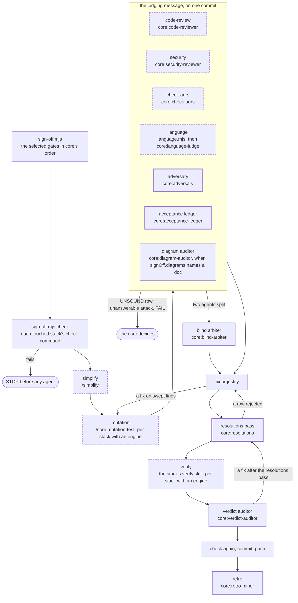

# skrymer-ai

A Claude Code plugin marketplace holding one AI-assisted development workflow, shared by every project that adopts it: test-first with an enforced TDD gate, decisions recorded as ADRs and a domain glossary, work planned as PRDs and vertical-slice issues, and a sign-off gate before anything is pushed.

## Plugins

| Plugin | What it gives a project |
|---|---|
| `core` | Process skills (tdd, grill-me, grill-with-docs, to-prd, to-issues, triage, handoff, diagnose, prototype, improve-codebase-architecture, check-adrs, feature-sign-off, mutation-test, write-a-skill, setup) and the hook engines (skill injection, skill gate, duplication gate, gated-write guard, test-output guard, formatter, Probity TDD gate) |
| `kotlin-spring` | Kotlin / Spring Boot backend playbook, pitest, Detekt, Gradle conventions |
| `react` | React playbook, component testing, Stryker, ESLint/Prettier |
| `sindri` | Consumer guide for the Sindri component library (sourced from its own repo) |
| `web-e2e` | Playwright best practices, MSW as the one way tests fake the API (with an ESLint preset refusing the alternatives), `/web-e2e:verify`, which walks an issue's acceptance criteria in a headless browser at each configured viewport and records a result per AC, and the default rules for e2e specs, tests and mock handlers |
| `nuxt` | Nuxt / Vue playbook, component-testing conventions, Vitest paths, Prettier + ESLint formatter |

## Adopting it

Once per machine:

```
/plugin marketplace add skrymer/skrymer-ai
/plugin install core@skrymer-ai
```

Then in a project, run `/core:setup`. It detects the stacks from each pack's marker files (a Gradle build applying Spring Boot, `nuxt.config.*`, `playwright.config.*`) and shows a diff of every change before writing any. It creates `.claude/skrymer-ai.config.mjs` (the only project-specific config) and an empty `CONTEXT.md` and `docs/adr/`. It merges the marketplace, the packs and their code-intelligence plugins into `.claude/settings.json` (one write you approve, since Claude Code protects that file, and then you run the plugin installs it lists), keeps a workflow section in `CLAUDE.md` between markers, and removes a project's own Probity setup, since `core` runs Probity itself. An existing project config is never rewritten: setup prints the `stacks` entry to add instead. Re-running it plans nothing on a set-up repo and migrates an older one, and `/core:setup --check` reports drift without writing. Until a project has a config, each session starts with a one-line nudge to run it.

## Project config

```js
// .claude/skrymer-ai.config.mjs
import { defineConfig } from 'skrymer-ai'

export default defineConfig({
  stacks: { 'kotlin-spring': { roots: ['api'] } },
  tdd: { files: ['tools/**/*.kts'] },
  skills: {
    files: [{ id: 'billing', path: /api\/src\/.*\/billing\//, skills: ['billing-rules'], why: 'Money rounds one way.' }],
    prompts: [{ id: 'billing', pattern: /\binvoic\w*|\bbilling\b/i, skills: ['billing-rules'], why: 'Money rounds one way.' }],
  },
  tracker: { kind: 'github', labels: { 'needs-triage': 'triage' } },
  domain: { contexts: ['.'] },
})
```

`'skrymer-ai'` resolves to the plugin when a hook loads the file, so the project installs nothing. Each pack adds its stack's rules under every root it is given. Rule paths are matched against the file's path relative to the project root, and a file needs every skill whose rule it matches. If the config is invalid, the gates let writes through and tell you why.

### Skill reminders and session context

On each prompt, `core` reminds the session of the skills whose `skills.prompts` rules match it: the packs' rules first, then the project's, then `core`'s own process rules (tdd, grill-with-docs, write-a-skill, handoff). A skill named by several matching rules is one reminder carrying every reason, a skill the prompt already invokes is left out, and a prompt gets at most three. A project rule's `pattern` is a regex, used as written, or a string, matched case-insensitively; it can set `worktreeScoped: true` for a skill a worktree serves its own copy of.

At session start, `core` tells the session the issue tracker (`github` or `local`), the project's label for each triage role (`bug`, `enhancement`, `needs-triage`, `needs-info`, `ready-for-agent`, `ready-for-human`, `wontfix`; each defaults to its own name) and the domain contexts, each a directory holding a `CONTEXT.md` and a `docs/adr/`. A config without `tracker` or `domain` gets GitHub and one context at the root; a project with no config gets only the nudge to run `/core:setup`. A bad `tracker` or `domain` block only withholds this context, and the gates and reminders stay on.

### Formatter

After each Write or Edit, `core` formats the file with the formatter of the stack whose root holds it, running in that root so the root's own Prettier and ESLint configs apply. A pack gives its formatter as `format` groups (`nuxt`: Prettier then `eslint --fix` on script and Vue files, Prettier alone on JSON, CSS, Markdown and YAML, both through `pnpm exec`). A stack replaces its pack's groups with its own:

```js
stacks: { nuxt: { roots: ['web'], format: [{ files: ['**/*.{ts,vue}'], run: [['npx', 'biome', 'format', '--write']] }] } }
```

Each group whose `files` globs match the file's path relative to the root runs its `run` commands in turn, with the file's path appended. A command is a list of words and runs without a shell. Formatting is best-effort: a formatter that fails or isn't installed is skipped, and the write stands. A file outside every root is left alone.

### TDD gate

A write to a TDD-gated file is judged by [Probity](https://github.com/nizos/probity), which `core` runs through `npx` at a pinned version, so the project needs no Probity config or install. The gated trees are each pack's source globs under its roots (`kotlin-spring`: `<root>/src/**/*.kt`; `nuxt`: `<root>/app/**/*.{ts,vue}`, `<root>/server/**/*.ts` and `<root>/shared/**/*.ts`) plus the project's `tdd.files`. The list is positive, so build output and generated code stay ungated. Two Bash guards keep the gate whole: a shell command can't write a gated file, and a test run can't be piped through `grep`, `head` or `tail`. The first gated write downloads Probity, which takes about 20 seconds. To use a local install instead, set `SKRYMER_AI_PROBITY` to the command that runs it, for example `node_modules/.bin/probity`. If Probity can't run, or runs past the hook's timeout, a gated write is denied with the reason.

### Duplication gate

A new test is refused while the branch holds duplicated source code it added, so the refactor step happens before the next red rather than at sign-off. A write counts as a new test when it lands on a file the pack's `duplication.tests` globs match (`kotlin-spring`: `<root>/src/*Test*/**/*.kt`, so integration tests and fixtures too; `nuxt`: `<root>/**/*.{test,spec}.{js,ts,…}`) and adds a test declaration. jscpd then scans that pack's TDD-gated trees under all of its roots, minus every pack's tests and whatever `.gitignore` leaves out, so Kotlin duplication never blocks a Vue test. A clone counts as the branch's when either copy overlaps a line the branch added or changed since it left origin's default branch (`origin/HEAD`, else `origin/main`), committed or not. A clone the branch only moved or didn't touch never blocks, and neither does one made only of imports, annotations and comments. The deny names each pair of copies and the refactorings out of it in the pack's terms. To keep a copy on purpose, wrap one side in `jscpd:ignore-start` / `jscpd:ignore-end` with a one-line reason.

`core` runs [jscpd](https://github.com/kucherenko/jscpd) through `npx` at a pinned version, with a config of its own, so a project's `.jscpd.json` doesn't change what the gate sees. Set `SKRYMER_AI_JSCPD` to use another command. The gate fails open: a scan that can't run lets the write through with "duplication-gate skipped: …" and the cause. On the first run the gate starts jscpd's download in the background and skips that one scan.

### Sign-off

`/core:feature-sign-off` runs once a change is functionally complete, before it is pushed. `signOff.gates` selects which gates run, and core runs them in its own order whatever order they are listed in: `simplify`, `mutation`, `code-review`, `security`, `check-adrs`, `language`, `verify`. `mutation` and `verify` need an engine: each runs once per stack root whose pack provides one (`kotlin-spring` and `nuxt` bring a mutation engine, `web-e2e` brings verify), and selecting one with no such pack is a config error. Without `signOff.gates`, every gate whose engine is available runs, apart from `security` and `language`, which run only when listed. `security` sends the diff to a read-only security reviewer that runs Claude Code's security review, and its findings are advisory. `language` runs `language.mjs`, which sets each type the branch declares, and each term the PRD puts in bold, against the glossary of the context it lands in, and a read-only language judge rules each mismatch a missing term or a misnamed concept. The adversary, the acceptance ledger, the resolutions pass and the retro run in every sign-off and can't be deselected. `signOff.docs` lists globs of the project's other living docs, which the check-adrs gate greps for drift beside `CLAUDE.md`, `README.md`, `docs/` and the glossaries in scope:

```js
signOff: { gates: ['simplify', 'code-review', 'check-adrs'], docs: ['handbook/**/*.md'], diagrams: ['docs/ARCHITECTURE.md'] }
```

`signOff.diagrams` names the docs whose Mermaid diagrams should still draw the code. Each must exist. When it names any, the **diagram auditor** joins the judging message and returns one row per diagram, CURRENT or STALE, and a MISSING tail for what the change added that no diagram draws. STALE and MISSING rows go through fix-or-justify, and a fixed diagram must pass the render check (`mermaid-check.mjs`), which renders each block through mermaid-cli and names any that doesn't render by its heading.

Before any agent is spawned, each stack the branch touched runs its pack's `check` commands in its root: the full build and tests (`kotlin-spring`: `./gradlew build`; `nuxt`: `pnpm lint`, `pnpm typecheck`, `pnpm test`). A failure stops the sign-off. A stack replaces its pack's commands with its own:

```js
stacks: { nuxt: { roots: ['web'], check: [['npm', 'run', 'lint'], ['npm', 'test']] } }
```

Every judgement in the run (the code review, check-adrs, the adversary, the ledger, the resolutions pass, a blind arbiter on a split, the verdict auditor, the retro miner) comes from a fresh read-only agent defined in `plugins/core/agents/`, never from a fork of the conversation ([ADR 0013](docs/adr/0013-core-orders-the-sign-off-and-fresh-read-only-agents-judge-it.md)). Scripts do the bookkeeping around them ([ADR 0014](docs/adr/0014-scripts-do-the-sign-offs-bookkeeping-and-agents-its-judging.md)): `brief.mjs` renders each agent's brief from its template in `plugins/core/skills/feature-sign-off/briefs/`, and before the resolutions pass reads the pack, `transcript.mjs check` rejects a judging agent with no transcript, one launched as a fork or as general-purpose rather than as its definition, one that never handed back, and a brief that differs from the rendered one.

## How the workflow runs

### The sign-off

The selected gates (dashed) in core's order, the fixed core (bold) that every sign-off runs, the agent that judges each step, and the loops back: a fix after the resolutions pass re-runs it, and a fix on lines the mutation gate swept re-runs the sweep. `signOff.gates` and each pack's engines and `check` drive it.



## Developing

`npm run check` runs the leak check and every hook test (`node --test`, no dependencies). The leak check fails the build when a term from `leak-denylist.txt` — a consuming project's name or domain — appears anywhere: everything here must be generic, and project specifics belong in the project's config.

`npm run evals` runs `core`'s skill evals (`plugins/core/evals/`) with `claude plugin eval`: an agent works each case in a throwaway workspace and graders score what it did. Run it before merging a change to a skill; `npm run evals -- --tag tdd` runs one skill's cases, and `npm run evals -- web-e2e --tag msw` runs a pack's (`plugins/<pack>/evals/`). It runs on your own Claude login, in a Docker container, and is not part of CI ([ADR 0007](docs/adr/0007-skill-evals-run-locally-before-a-skill-change-merges.md)). On Ubuntu 24.04 and later, the container needs an AppArmor profile that lets Claude Code's Bash sandbox create user namespaces. Load it once per boot:

```sh
sudo apparmor_parser -r scripts/evals/apparmor-profile
```

A diagram is checked by rendering it, not by GitHub parsing it. `npm run check` renders every Mermaid block in this README through `plugins/core/scripts/mermaid-check.mjs`, which runs mermaid-cli at a pinned version through `npx`, and so needs a Chromium for Puppeteer. If Puppeteer can't start its own, set `SKRYMER_AI_PUPPETEER_CONFIG` to a Puppeteer config file that points at a local one, such as `{"executablePath": "<path to chrome>"}`. CI writes one that turns Chromium's sandbox off, since Ubuntu's runners restrict the user namespaces it needs.
